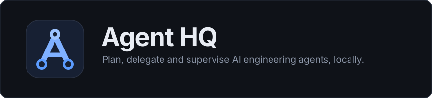

<p align="center">
  
</p>

<p align="center">
  A local workbench where one orchestrator plans the work, assembles a team of AI agents for your project, and supervises them while you watch.
</p>

---

## What it is

You open a project folder, describe what you need to **Sovereign** (the orchestrator), review the plan it proposes, and approve it. Agents then work on the tasks in dependency order, each with the model Sovereign picked for that task. Everything runs on your machine and uses the AI subscriptions and CLIs you already have.

## Features

| Area | What you get |
| --- | --- |
| **Workspace** | File explorer, multi-tab editor, diff view, terminal (allow-listed commands, no shell), agent logs, problems, and the orchestrator chat. Resizable panels, code and chat layouts. |
| **Orchestrator** | Ask, Plan and Build modes. Plans list tasks, assigned agents and models; you can edit, remove or reassign before approving. |
| **Adaptive team** | Sovereign can design the team for the project, including new agents, or you can restrict it to your own agents. |
| **Agents** | Graph, Office and List views. The graph supports zoom, pan, dragging nodes and reset. The Office is a floor plan; monitors light up while an agent works. Change models, add agents, onboard juniors. |
| **Custom specialties** | Onboard a junior in any field (for example IoT and Embedded): name it, say what it should study, and choose the role it graduates into. Its focus goes into its system prompt. |
| **Connections & Models** | Detects installed CLIs, connects providers, discovers real models, and sets default models per role. |
| **Failover** | If a provider runs out of credit during a run, affected agents are rerouted to another connected provider and the switch is logged. |
| **Tasks** | Kanban with the stages Briefing, Architecture, Implementation, Code Review & QA, Shipped, and the N+1 senior review. |
| **Reports** | Usage, cost and run history from recorded data. |

## Connecting models

Agent HQ only uses supported mechanisms. It never reads or reuses another tool's credentials.

| Provider | Methods |
| --- | --- |
| Anthropic | API key, environment key, **Claude Code CLI** (uses its own sign-in) |
| OpenAI | API key, environment key, **Codex CLI** (uses its own sign-in) |
| Google | API key, Gemini CLI (when installed) |
| Ollama | Local HTTP endpoint, installed models are listed |

CLIs are looked up on `PATH` plus common install locations (nvm, npm global, bun, volta, `~/.claude/local`). A connection is only marked connected after a real test call succeeds. Codex models are read from the CLI's own model cache; the Claude CLI exposes aliases only (`sonnet`, `opus`, `haiku`, `default`).

## Run it

```bash
npm install
npm run dev        # http://localhost:5173
```

1. Open **Connections** and connect a provider (or a signed-in CLI).
2. Under **Role defaults**, assign models, or press **Fill empty roles**.
3. Click the project button in the sidebar to open or create a project folder.
4. In **Workspace**, choose **Plan**, describe the work, review the plan, and **Approve & run**.

| Shortcut | Action |
| --- | --- |
| `Alt+1` to `Alt+4` | Workspace, Agents, Tasks, Reports |
| `Ctrl+K` | Command palette |
| `+` `-` `0` and arrows | Zoom and pan on the agent canvas |

Other scripts: `npm run build`, `npm run typecheck`, `npm test` (unit tests), `npm run test:e2e`.

## Architecture

- `src/` React 19, Zustand, Tailwind 4. `src/engine/liveOrchestrator.ts` plans and runs missions.
- `server/` API served as Vite middleware: provider connections, chat streaming, project filesystem, git and the restricted command runner. Server code does not hot-reload; restart `npm run dev` after changing it.
- Agents run only inside the opened project folder. The dev server binds to the LAN (`--host`) and relies on a loopback guard for sensitive routes; do not expose it to an untrusted network.

## Limitations

- Agent file changes are not written automatically; apply them from the **Changes** tab.
- A demo run exists for exploring the visualizations and is labelled `demo` everywhere it appears.
- Cost is only shown for models with verified pricing; otherwise tokens are shown without a price.
- The end-to-end Playwright spec still targets the previous UI and needs rewriting.
- Gemini CLI integration is untested on this machine (the CLI is not installed).
