<p align="center">
  
</p>

<h1 align="center">Agent HQ</h1>

<p align="center">
  <strong>A local command center for teams of AI coding agents.</strong>
</p>

<p align="center">
  One orchestrator plans the work, assembles the right agents for your project and supervises them<br />
  while you review every plan and every change. It runs on your machine with the subscriptions you already have.
</p>

<p align="center">
  <a href="https://github.com/orcalinux/agent-hq/actions/workflows/ci.yml"></a>
  <a href="CHANGELOG.md"></a>
  
  
  
  
  
  
  
</p>

<p align="center">
  <a href="#quick-start"><b>Quick start</b></a> ·
  <a href="#desktop-app"><b>Desktop app</b></a> ·
  <a href="#features"><b>Features</b></a> ·
  <a href="#how-a-run-works"><b>How a run works</b></a> ·
  <a href="#connecting-models"><b>Connections</b></a> ·
  <a href="#architecture-and-security"><b>Security</b></a> ·
  <a href="#testing"><b>Testing</b></a>
</p>

<p align="center">
  
</p>

---
## What it is

You open a project folder, describe what you need to **Sovereign** (the orchestrator), review the plan it proposes, and approve it. Agents then work on the tasks in dependency order (independent tasks run in parallel), each with the model Sovereign picked for that task. Everything runs on your machine and uses the AI subscriptions and CLIs you already have.

## Highlights

- **Plan first, then build.** Sovereign proposes tasks, agents and models; you edit and approve before anything runs.
- **Parallel by design.** Independent tasks run in waves, up to 3 at once by default (Settings → Team building: 1 to 8, or no limit) and never two at once for the same agent.
- **Reviewed work.** Juniors get an N+1 senior review, and Sentinel QA can send work back once for rework.
- **Sovereign builds the team.** For each plan, Sovereign decides how many agents are needed, their names and exact models, and which are juniors under which senior. There is no cap on agents or tasks, and new agents stay on the team. See [Team building and mentors](#team-building-and-mentors).
- **Agents that learn.** Each project has a long-term memory in `.agent-hq/memory/lessons.json`. Agents are taught with `/remember`, learn from QA and mentor feedback and from a short reflection after every run, and receive the relevant lessons in their next prompt. **Insights → Growth** shows each agent's level, focus areas and learning over time. See [Agent memory](#agent-memory).
- **You choose how much to trust the agents.** By default edits arrive as diffs in the **Changes** tab and are only written when you apply them. **Auto-apply** writes QA-approved changes for you, and **Full access** also skips plan approval. Every auto-applied file can be undone.
- **Local and bring-your-own-model.** Claude Code, Codex, Gemini, Ollama and the Magpie gateway, with automatic failover when a provider runs out of credit.
- **Looks right on your system.** The theme is **System** by default (light or dark, following your OS live) and can be pinned to Light or Dark. The sidebar glides open and shut, and the editor has modern file tabs with an unsaved dot.
- **Installs the missing pieces for you.** In **Connections → Local tools**, every missing tool (Claude Code, Codex, Gemini CLI, Ollama, Magpie) has an **Install** button that opens your own terminal in the project and runs the official command, plus **Copy** and **Docs**.
- **A real terminal built in, like VS Code.** The bottom panel's **Terminal** tab is a full interactive shell (your `$SHELL`, colors, `Ctrl+C`, resize, multiple tabs) that starts in the project folder. Open it with `` Ctrl+` `` or the command palette; shells survive panel switches and window reloads, and stop when the app quits. Prefer your own emulator? **Open in external terminal app** is still in the panel header and the command palette.
- **A real desktop app.** `.deb`, `.rpm`, AppImage, Windows and macOS installers, with a tray icon that shows the run, notifications, `agenthq://` links and auto-update.

<table>
  <tr>
    <td width="50%">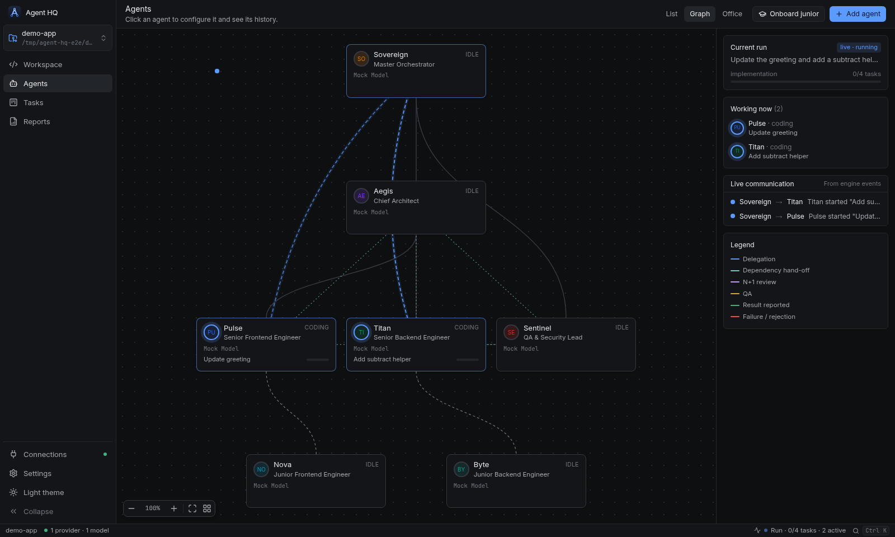<br /><sub><b>Agents</b>: live graph of the team mid-run</sub></td>
    <td width="50%">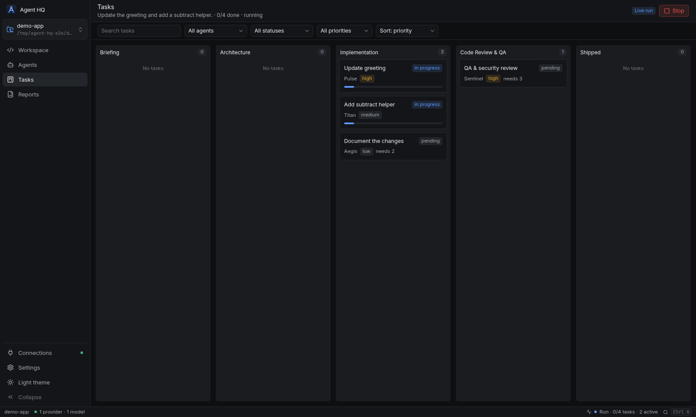<br /><sub><b>Tasks</b>: board from briefing to shipped</sub></td>
  </tr>
  <tr>
    <td width="50%">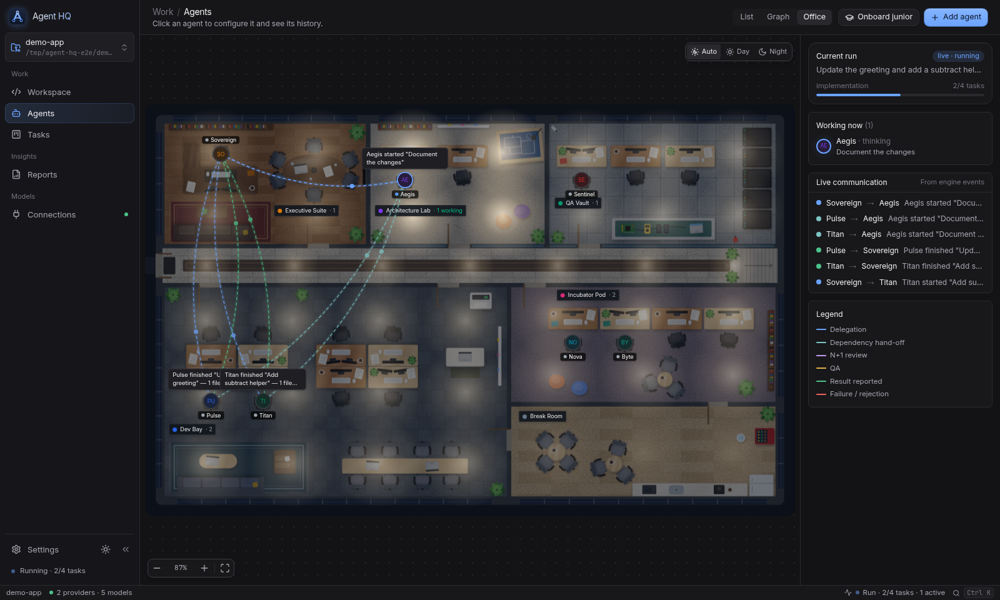<br /><sub><b>Office</b>: the team at work, monitors light up while an agent codes</sub></td>
    <td width="50%">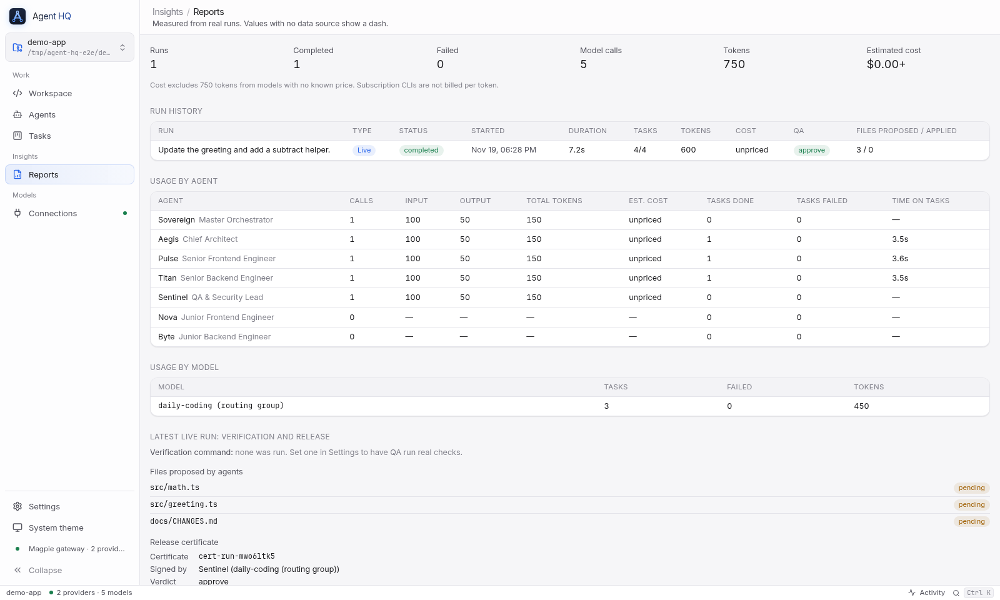<br /><sub><b>Reports</b>: usage, cost and run history from real runs</sub></td>
  </tr>
  <tr>
    <td width="50%">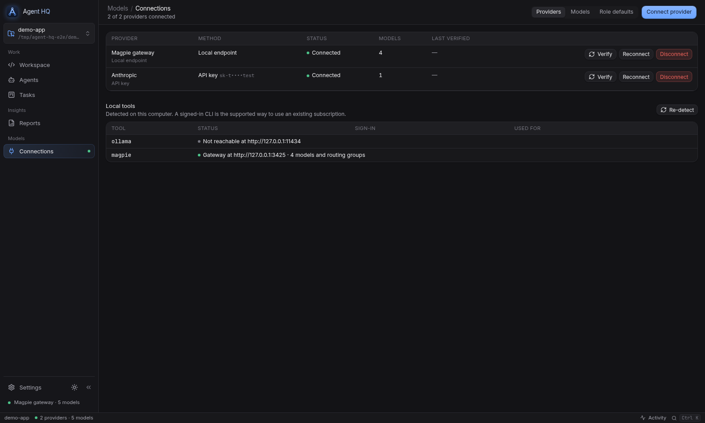<br /><sub><b>Connections</b>: Magpie gateway and other providers</sub></td>
    <td width="50%">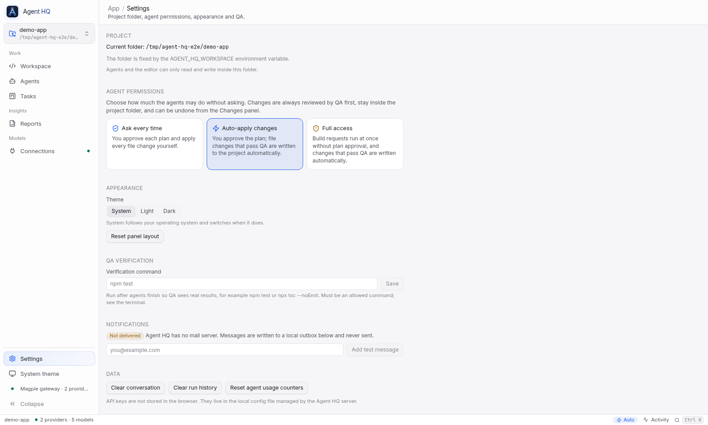<br /><sub><b>Settings</b>: Ask, Auto-apply or Full access</sub></td>
  </tr>
  <tr>
    <td width="50%">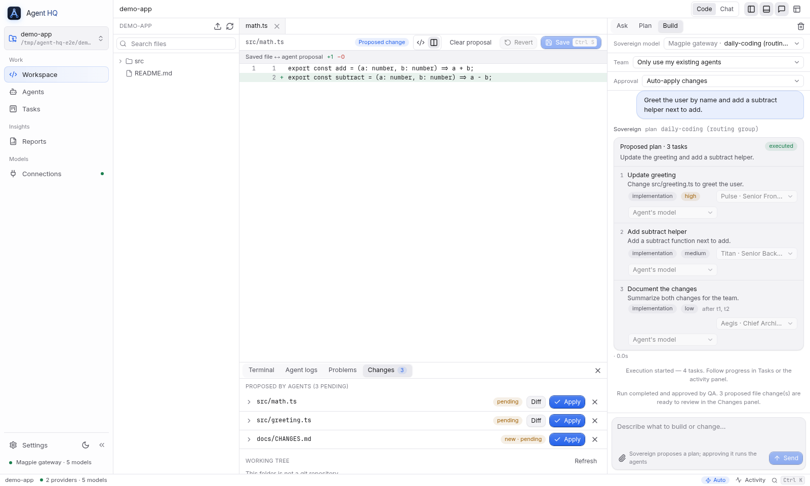<br /><sub><b>Light theme</b>: follows your system by default</sub></td>
    <td width="50%">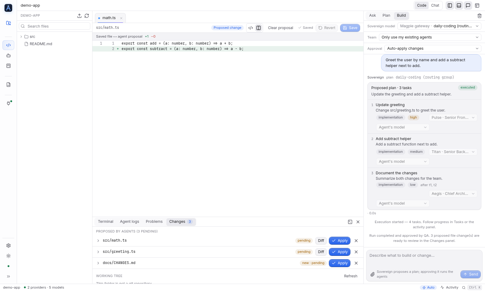<br /><sub><b>Collapsed sidebar</b>: smooth slide to icons, editor tabs with unsaved dots</sub></td>
  </tr>
  <tr>
    <td colspan="2">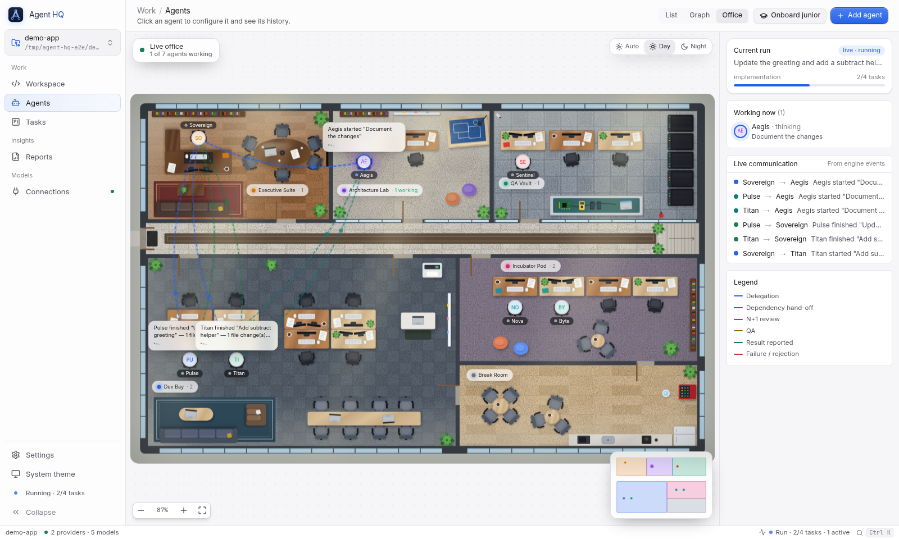<br /><sub><b>Office</b>: daylight, live minimap, glass HUD and speech bubbles; it fades to night with the theme</sub></td>
  </tr>
  <tr>
    <td colspan="2">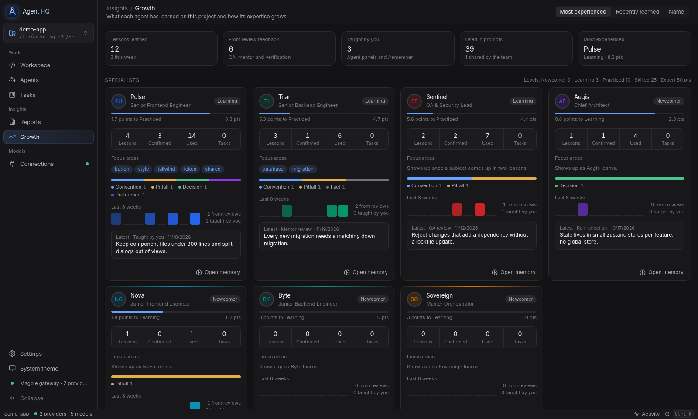<br /><sub><b>Growth</b>: each agent's level, focus areas and learning over the last 8 weeks</sub></td>
  </tr>
</table>

## How a run works

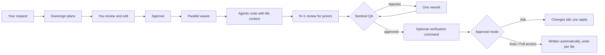

## Agent permissions (auto mode)

Like the permission modes in Claude Code and Codex, you decide how much the agents may do without asking. Pick a mode in **Settings → Agent permissions** or in the chat panel; the title bar and status bar show it while it is on.

| Mode | Plans | File changes |
| --- | --- | --- |
| **Ask every time** (default) | You approve each plan | You apply each change in the Changes tab |
| **Auto-apply changes** | You approve each plan | Written automatically once Sentinel QA approves the run |
| **Full access** | Build requests start running at once | Written automatically once Sentinel QA approves the run |

Turning on a more permissive mode asks for confirmation first. Auto mode never writes work that QA rejected, only writes inside the project folder, and keeps each file's previous contents: **Undo** in the Changes tab restores the file, or deletes it if the agent created it. Every automatic write is logged in the activity panel.

## Agent memory

Agents keep what they learn **per project**, in plain JSON you can read, edit and commit: `<project>/.agent-hq/memory/lessons.json`. A `.gitignore` inside `.agent-hq/memory/` keeps the search index out of git.

- **Teach directly.** In chat, `/remember Always run the formatter before QA` saves a lesson for the whole team; `/remember @Pulse Use Tailwind classes, not inline styles` saves it for one agent. Agents → pick an agent → **Memory** has a Teach form, search, pin, edit and delete.
- **Learn from feedback.** Mentor revisions, QA rejections and failed verification are journaled; after the run Sovereign reflects on them and saves up to 6 short lessons. Repeats reinforce the existing lesson instead of adding a copy.
- **Use it.** Pinned lessons come first, then the ones that best match the task, within a fixed prompt budget. The activity log shows when an agent learned something.
- **Learning mode** (Settings → Memory and learning): **Every run** (default), **Only from feedback**, or **Off**.
- **Search by meaning.** Lessons are always searched by keyword. If [Ollama](https://ollama.com) is running, Agent HQ also uses an embedding model (`nomic-embed-text` preferred) so "change the look of a button" finds a lesson about Tailwind. Install it from Settings with one click; otherwise search stays keyword-only. Everything stays on your computer.
- **Safe by design.** Memory files stay inside the project, agents cannot overwrite them through file blocks, and a malformed file is reported rather than replaced.

### Watching agents grow

**Insights → Growth** (`Alt+6`) has a card per agent, so you can follow each one's specialization:

- **Level**, from Newcomer through Learning, Practiced and Skilled to Expert, with progress to the next level. Points come from the agent's own lessons (each lesson 1, plus 0.5 per time it was confirmed again up to 6, 0.2 per time it was used in a prompt up to 10, 0.5 if pinned) and 0.5 per finished task.
- **Focus areas**: the subjects that come up in at least two of its lessons, such as `tailwind` or `migration`.
- **Lessons, confirmations, uses and tasks** with the success rate, the mix of lesson kinds, lessons per week over the last 8 weeks, how many came from reviews or from you, and the latest lesson.
- Team totals, a team learning chart and a feed of the newest lessons. **Open memory** jumps to the agent's Memory panel. On the desktop, the tray's quick status shows the lesson count and the most experienced agent.

## Team building and mentors

- **Every junior has a mentor.** A senior, or Sovereign as the direct manager, reviews their work (N+1). Onboarding suggests one by specialty; change it any time in the agent's **Internship** card. A senior's **Mentors** card lists their juniors.
- **Sovereign builds the team.** In a plan it chooses the number of agents, their names, exact models, and juniors with mentors, then creates them when you approve. They stay on the team.
- **No caps** on agents or tasks. How many tasks run at once is a setting (default 3, up to no limit) in Settings → Team building.
- **Settings → Team building:** *Sovereign, automatically* (default) or *Only my agents*.

## Features

| Area | What you get |
| --- | --- |
| **Workspace** | File explorer, multi-tab editor, integrated terminal with tabs, diff view, an **Agent commands** runner (allow-listed commands, no shell), agent logs, problems, and the orchestrator chat. Resizable panels, code and chat layouts. |
| **Orchestrator** | Ask, Plan and Build modes. Plans list tasks, assigned agents and models; you can edit, remove or reassign before approving. Runs execute in dependency waves, up to 3 tasks at once by default (configurable, or no limit) and never two at once for the same agent. Each task receives the current contents of the files attached to the request and of the workspace files its description names, so agents edit existing code instead of rewriting it. |
| **Adaptive team** | Sovereign designs the team for the work, with no limit on agents or tasks, exact models and juniors with mentors; or restrict it to your own agents in Settings → Team building. |
| **Agents** | Graph, Office and List views. The graph supports zoom, pan, dragging nodes and reset. The Office is a live floor plan with a glass HUD, minimap, daylight that fades to night, animated avatars and speech bubbles; monitors light up while an agent works. Change models, add agents, onboard juniors with an N+1 mentor you can change any time. |
| **Custom specialties** | Create or edit any agent with a free-text role/specialty (IoT, embedded firmware, robotics, or any domain) and domain instructions. Sovereign sees these when assigning tasks, and the agent receives them on every task. Workflow categories preserve routing and model defaults. Junior agents also support custom study tracks. |
| **Connections & Models** | Detects installed CLIs, connects providers, discovers real models, and sets default models per role. |
| **Failover** | If a provider runs out of credit during a run, affected agents are rerouted to another connected provider and the switch is logged. |
| **Tasks** | Kanban with the stages Briefing, Architecture, Implementation, Code Review & QA, Shipped, and the N+1 senior review. |
| **Reports** | Usage, cost and run history from recorded data. |

## Connecting models

Agent HQ only uses supported mechanisms. It never reads or reuses another tool's credentials.

| Provider | Methods |
| --- | --- |
| Anthropic | API key, environment key, **Claude Code CLI** (uses its own sign-in) |
| OpenAI | API key, environment key, **Codex CLI** (uses its own sign-in) |
| Google | API key, Gemini CLI (when installed) |
| Ollama | Local HTTP endpoint, installed models are listed |
| [Magpie](https://usemagpie.ai) | Its local gateway: every model and routing group you set up in Magpie, with its subscriptions and failover |

**Magpie.** If you use [Magpie](https://usemagpie.ai) to manage models and accounts, connect **Magpie gateway** and every model and routing group it offers (for example `group/smart-coding`) becomes available to each agent, without Agent HQ holding any keys. The address is read from Magpie's own `gateway.json` (default `http://127.0.0.1:3425`); set `MAGPIE_GATEWAY` to point elsewhere and `MAGPIE_API_KEY` if your gateway requires a caller key.

<p align="center">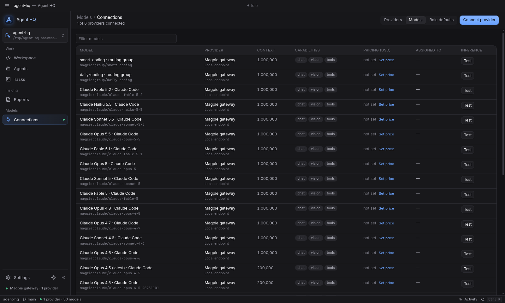<br /><sub>The desktop app connected to a real Magpie gateway: its routing groups and every model from the Claude Code and Codex accounts set up in Magpie.</sub></p>

Agent HQ talks to models as plain text and tells every model that it has no tools, because gateways that wrap an agent account (Magpie with Claude Code or Codex) may otherwise let a model try a tool call and leak it into the answer.

CLIs are looked up on `PATH` plus common install locations (nvm, npm global, bun, volta, `~/.claude/local`). A connection is only marked connected after a real test call succeeds. Codex models are read from the CLI's own model cache.

Claude Code models come from the signed-in account's local catalog, matched to its account and organization, plus the older model caches in `.claude.json`. Pickers show exact model names and versions, such as **Claude Opus 5.5**, and selections pass the explicit model ID to the CLI. Account-denied models are excluded. No aliases are offered as model choices. Previously saved automatic assignments migrate to the exact ID once a verification or run has identified it; unresolved assignments ask you to choose an exact model. **Verify** runs a short test prompt, and a subsequent response can add a newly reported model when no local catalog exists.

## Quick start

```bash
npm install
npm run dev        # http://localhost:5173
```

1. Open **Connections** and connect a provider (or a signed-in CLI).
2. Under **Role defaults**, assign models, or press **Fill empty roles**.
3. Click the project button in the sidebar to open or create a project folder.
4. In **Workspace**, choose **Plan**, describe the work, review the plan, and **Approve & run**.

| Shortcut | Action |
| --- | --- |
| `Alt+1` to `Alt+4` | Workspace, Agents, Tasks, Reports |
| `Ctrl+K` | Command palette |
| `+` `-` `0` and arrows | Zoom and pan on the agent canvas |

Other scripts: `npm start` (build once and serve on `127.0.0.1:5173` without Vite), `npm run build`, `npm run typecheck`, `npm test` (unit tests), `npm run test:e2e`, `npm run dev:lan` (also listen on the LAN).

## Desktop app

Download the installer for your system from [Releases](https://github.com/orcalinux/agent-hq/releases), then:

| System | File | Install |
| --- | --- | --- |
| Debian, Ubuntu, Mint, Pop!_OS | `.deb` | `sudo apt install ./Agent-HQ-*.deb` |
| Fedora, RHEL, Rocky, Alma, openSUSE | `.rpm` | `sudo dnf install ./Agent-HQ-*.rpm` (`sudo zypper install` on openSUSE) |
| Any Linux | `.AppImage` | `chmod +x Agent-HQ-*.AppImage` and run it |
| Windows | `.exe` | Run the installer |
| macOS | `.dmg` | Drag Agent HQ to Applications |

The `.deb` and `.rpm` packages pull in their dependencies, add Agent HQ to the application menu and register `agenthq://` links. Or run it from source:

```bash
npm run desktop        # build and open the desktop app
npm run desktop:dev    # the desktop app on the Vite dev server, with hot reload
npm run dist:desktop   # build installers for this system into release/
```

<p align="center">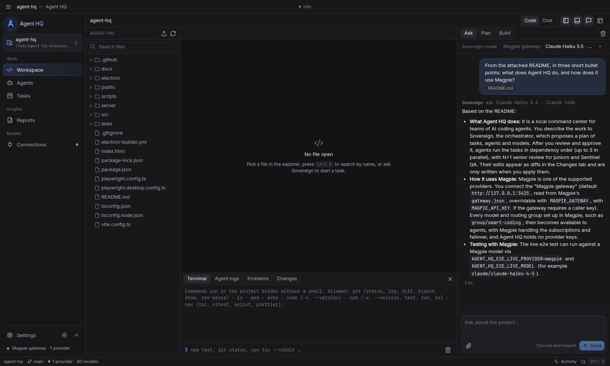<br /><sub>The desktop app on Linux: Sovereign answers through a Magpie routed Claude model.</sub></p>

The desktop app runs the same UI and server inside one window, so there is nothing to start first. It shares connections and settings with the browser version (`~/.config/agent-hq`).

- **Custom title bar** in the app's design, with the project name, the live run status and an application menu; the native window buttons follow the light or dark theme.
- **Tray quick status**: click the icon beside your system's battery and network icons to see the project, task progress, measured usage, agent models and recent activity. Its Overview, Agents and Activity tabs use the app's theme; select an agent to open its configuration. Escape or clicking outside dismisses the panel. **View → Quick status** (`Ctrl+Shift+Space`, or `Cmd+Shift+Space` on macOS) opens the same panel. Some Linux tray hosts show a menu first; choose **Quick status** there.
- Closing the main window keeps Agent HQ in the tray, including when idle. Use **Quit** in the panel or application menu to exit.
- **Notifications** when a plan is ready for review or a run finishes or fails while the window is in the background.
- **Native menu**: open a project (`Ctrl+O`), switch views, command palette, zoom, full screen.
- **`agenthq://` links**: `agenthq://open?path=/abs/project` opens a project after asking you, `agenthq://view/agents` shows a view.
- **Single instance**, remembered window size and position.
- **Updates itself** from GitHub releases (AppImage, `.deb`, `.rpm`, Windows and macOS). A new version downloads in the background; an **↑ Update** pill in the title bar shows what changed and restarts into it, or waits until no agent is working. **Settings › Updates** sets how often it checks, whether it downloads and restarts by itself, and opens What's new.

To publish a release, bump `version` in `package.json` and push a tag such as `v0.2.0`. `.github/workflows/release.yml` builds the installers on Linux, Windows and macOS and attaches them to the GitHub release. The builds are not code-signed yet, so Windows SmartScreen and macOS Gatekeeper warn on first launch; on macOS, right-click the app and choose **Open**.

## Testing

`npm run test:e2e` starts its own server on `127.0.0.1:5180` (override with `AGENT_HQ_E2E_PORT`) against a throwaway project in the system temp folder, with a separate config folder, so it never touches your projects or connections. The model provider is replaced by scripted responses, so no account is needed. The suite covers every view, the terminal allowlist, and a full plan → approve → run → QA → apply flow, including parallel tasks and file context.

The UI regression suite also checks role assignment and persistence, System/Light/Dark themes, permission confirmation and cancellation, QA settings, editor save/revert and keyboard shortcuts, sidebar collapse, Office lighting, and recovery from a missing view module without clearing saved data. The project picker is checked above the full app with both expanded and collapsed sidebars, including keyboard focus, folder selection and project creation. Installer and external-terminal requests are mocked so tests do not install tools or open terminal windows. The integrated terminal is tested against real shells in the browser and inside Electron, including cleanup on quit, and the project picker's type-to-filter is covered too.

Run `npm run build && AGENT_HQ_E2E_BUILT=1 npm run test:e2e` to exercise the production bundle rather than the development server. CI runs both modes. Layout checks capture Role defaults and Settings at 1000px and 1440px in light and dark themes with reduced motion; screenshots stay in `test-results/`.

Local builds retain existing hashed assets so an open desktop window can still load its views during a rebuild. If a module is unavailable, **Reload app** loads the latest entry point without clearing saved agents, conversations or settings.

To run the same flow against a real model with nothing mocked, pass an installed Ollama model: `AGENT_HQ_E2E_LIVE_MODEL=qwen2.5:7b npm run test:e2e -- live-provider` (set `AGENT_HQ_E2E_OLLAMA` if Ollama is not on `127.0.0.1:11434`), or a Magpie model: `AGENT_HQ_E2E_LIVE_PROVIDER=magpie AGENT_HQ_E2E_LIVE_MODEL=claude/claude-haiku-5-5 npm run test:e2e -- live-provider`. Without the variable the live test is skipped. Ollama answers parallel requests one at a time unless `OLLAMA_NUM_PARALLEL` is raised.

`npm run test:desktop` builds the desktop app and drives it with Playwright: its own server, the preload bridge (with no Node access in the page), menus, external links opening outside the app, remembered window size, and hiding to the tray during a run. It uses throwaway folders for the project, config and app data.

Desktop tests also open every view from the built app, check the role cards and Settings navigation, and simulate a missing JavaScript module to verify reload recovery. Desktop traces are stored separately in `test-results-desktop/`.

To regenerate the README screenshots: `AGENT_HQ_SCREENSHOTS=1 npm run test:e2e -- screenshots`. After changing the logo, `npm run icons` renders the app, installer and tray icons. CI (`.github/workflows/ci.yml`) runs typecheck, unit tests, build, the e2e suite and the desktop tests on every push and pull request.

## Architecture and security

- `src/` React 19, Zustand, Tailwind 4. `src/engine/liveOrchestrator.ts` plans and runs missions.
- `server/` API served as Vite middleware in development, and by `server/standalone.ts` (a small Node HTTP server that also serves the built UI) in `npm start` and the desktop app: provider connections, chat streaming, project filesystem, git and the restricted command runner. Server code does not hot-reload; restart `npm run dev` after changing it.
- `electron/` the desktop shell. The page runs sandboxed with context isolation and no Node access; it only gets a small preload bridge (status, notifications, commands). Navigation away from the app opens in your browser instead, permissions other than notifications are refused, and the built UI is served with a strict Content Security Policy.
- Agents run only inside the opened project folder. File access resolves symlinks, so a link inside the project cannot reach files outside it.
- The integrated terminal is a real shell for *you*; it is only reachable from this machine and is never available to agents. Agents and the **Agent commands** tab run allow-listed programs without a shell. Git options that write files or run helpers (`--output`, `--ext-diff`, `--textconv`, …) are refused, paths outside the project are refused (including in `--option=value`), and `npx` only runs packages that are already installed.
- The dev server listens on `127.0.0.1` only. `npm run dev:lan` also listens on the LAN; the API still accepts only loopback requests, but do not use it on an untrusted network.

## Limitations

- Agent file changes are not written automatically; apply them from the **Changes** tab.
- A demo run exists for exploring the visualizations and is labelled `demo` everywhere it appears.
- Cost is only shown for models with verified pricing; otherwise tokens are shown without a price. Claude Code models are priced from the API rate card the CLI caches for your account, including cache reads and writes. On a subscription this values usage at API rates and is not a bill.
- Gemini CLI integration is untested on this machine (the CLI is not installed).
