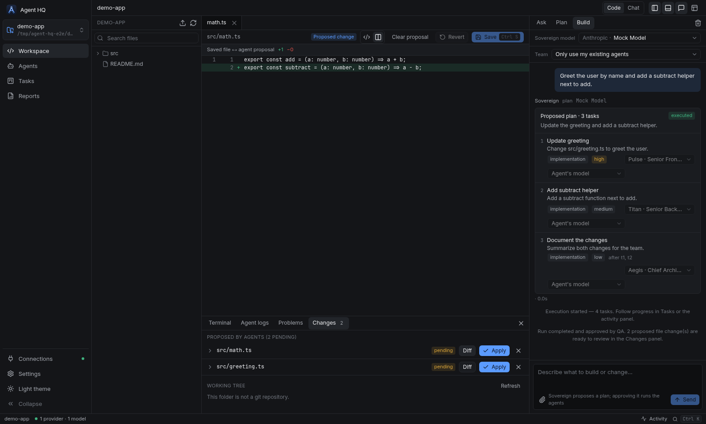
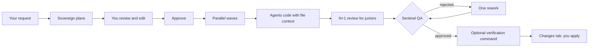

<p align="center">
  
</p>

<h1 align="center">Agent HQ</h1>

<p align="center">
  <strong>A local command center for teams of AI coding agents.</strong>
</p>

<p align="center">
  One orchestrator plans the work, assembles the right agents for your project and supervises them<br />
  while you review every plan and every change. It runs on your machine with the subscriptions you already have.
</p>

<p align="center">
  <a href="https://github.com/orcalinux/agent-hq/actions/workflows/ci.yml"></a>
  
  
  
  
  
  
  
</p>

<p align="center">
  <a href="#quick-start"><b>Quick start</b></a> ·
  <a href="#features"><b>Features</b></a> ·
  <a href="#how-a-run-works"><b>How a run works</b></a> ·
  <a href="#connecting-models"><b>Connections</b></a> ·
  <a href="#architecture-and-security"><b>Security</b></a> ·
  <a href="#testing"><b>Testing</b></a>
</p>

<p align="center">
  
</p>

---
## What it is

You open a project folder, describe what you need to **Sovereign** (the orchestrator), review the plan it proposes, and approve it. Agents then work on the tasks in dependency order (independent tasks run in parallel), each with the model Sovereign picked for that task. Everything runs on your machine and uses the AI subscriptions and CLIs you already have.

## Highlights

- **Plan first, then build.** Sovereign proposes tasks, agents and models; you edit and approve before anything runs.
- **Parallel by design.** Independent tasks run in waves, up to 3 at once and never two at once for the same agent.
- **Reviewed work.** Juniors get an N+1 senior review, and Sentinel QA can send work back once for rework.
- **You stay in control.** Agent edits arrive as diffs in the **Changes** tab and are only written when you apply them.
- **Local and bring-your-own-model.** Claude Code, Codex, Gemini and Ollama, with automatic failover when a provider runs out of credit.

<table>
  <tr>
    <td width="50%"><br /><sub><b>Agents</b>: live graph of the team mid-run</sub></td>
    <td width="50%"><br /><sub><b>Tasks</b>: board from briefing to shipped</sub></td>
  </tr>
</table>

## How a run works



## Features

| Area | What you get |
| --- | --- |
| **Workspace** | File explorer, multi-tab editor, diff view, terminal (allow-listed commands, no shell), agent logs, problems, and the orchestrator chat. Resizable panels, code and chat layouts. |
| **Orchestrator** | Ask, Plan and Build modes. Plans list tasks, assigned agents and models; you can edit, remove or reassign before approving. Runs execute in dependency waves, up to 3 tasks at once and never two at once for the same agent. Each task receives the current contents of the files attached to the request and of the workspace files its description names, so agents edit existing code instead of rewriting it. |
| **Adaptive team** | Sovereign can design the team for the project, including new agents, or you can restrict it to your own agents. |
| **Agents** | Graph, Office and List views. The graph supports zoom, pan, dragging nodes and reset. The Office is a floor plan; monitors light up while an agent works. Change models, add agents, onboard juniors. |
| **Custom specialties** | Create or edit any agent with a free-text role/specialty (IoT, embedded firmware, robotics, or any domain) and domain instructions. Sovereign sees these when assigning tasks, and the agent receives them on every task. Workflow categories preserve routing and model defaults. Junior agents also support custom study tracks. |
| **Connections & Models** | Detects installed CLIs, connects providers, discovers real models, and sets default models per role. |
| **Failover** | If a provider runs out of credit during a run, affected agents are rerouted to another connected provider and the switch is logged. |
| **Tasks** | Kanban with the stages Briefing, Architecture, Implementation, Code Review & QA, Shipped, and the N+1 senior review. |
| **Reports** | Usage, cost and run history from recorded data. |

## Connecting models

Agent HQ only uses supported mechanisms. It never reads or reuses another tool's credentials.

| Provider | Methods |
| --- | --- |
| Anthropic | API key, environment key, **Claude Code CLI** (uses its own sign-in) |
| OpenAI | API key, environment key, **Codex CLI** (uses its own sign-in) |
| Google | API key, Gemini CLI (when installed) |
| Ollama | Local HTTP endpoint, installed models are listed |

CLIs are looked up on `PATH` plus common install locations (nvm, npm global, bun, volta, `~/.claude/local`). A connection is only marked connected after a real test call succeeds. Codex models are read from the CLI's own model cache; the Claude CLI exposes aliases only (`sonnet`, `opus`, `haiku`, `default`).

## Quick start

```bash
npm install
npm run dev        # http://localhost:5173
```

1. Open **Connections** and connect a provider (or a signed-in CLI).
2. Under **Role defaults**, assign models, or press **Fill empty roles**.
3. Click the project button in the sidebar to open or create a project folder.
4. In **Workspace**, choose **Plan**, describe the work, review the plan, and **Approve & run**.

| Shortcut | Action |
| --- | --- |
| `Alt+1` to `Alt+4` | Workspace, Agents, Tasks, Reports |
| `Ctrl+K` | Command palette |
| `+` `-` `0` and arrows | Zoom and pan on the agent canvas |

Other scripts: `npm run build`, `npm run typecheck`, `npm test` (unit tests), `npm run test:e2e`, `npm run dev:lan` (also listen on the LAN).

## Testing

`npm run test:e2e` starts its own server on `127.0.0.1:5180` (override with `AGENT_HQ_E2E_PORT`) against a throwaway project in the system temp folder, with a separate config folder, so it never touches your projects or connections. The model provider is replaced by scripted responses, so no account is needed. The suite covers every view, the terminal allowlist, and a full plan → approve → run → QA → apply flow, including parallel tasks and file context.

To run the same flow against a real local model with nothing mocked, pass an installed Ollama model: `AGENT_HQ_E2E_LIVE_MODEL=qwen2.5:7b npm run test:e2e -- live-ollama` (set `AGENT_HQ_E2E_OLLAMA` if Ollama is not on `127.0.0.1:11434`). Without the variable the live test is skipped. Ollama answers parallel requests one at a time unless `OLLAMA_NUM_PARALLEL` is raised.

To regenerate the README screenshots: `AGENT_HQ_SCREENSHOTS=1 npm run test:e2e -- screenshots`. CI (`.github/workflows/ci.yml`) runs typecheck, unit tests, build and the e2e suite on every push and pull request.

## Architecture and security

- `src/` React 19, Zustand, Tailwind 4. `src/engine/liveOrchestrator.ts` plans and runs missions.
- `server/` API served as Vite middleware: provider connections, chat streaming, project filesystem, git and the restricted command runner. Server code does not hot-reload; restart `npm run dev` after changing it.
- Agents run only inside the opened project folder. File access resolves symlinks, so a link inside the project cannot reach files outside it.
- The terminal runs allow-listed programs without a shell. Git options that write files or run helpers (`--output`, `--ext-diff`, `--textconv`, …) are refused, paths outside the project are refused (including in `--option=value`), and `npx` only runs packages that are already installed.
- The dev server listens on `127.0.0.1` only. `npm run dev:lan` also listens on the LAN; the API still accepts only loopback requests, but do not use it on an untrusted network.

## Limitations

- Agent file changes are not written automatically; apply them from the **Changes** tab.
- A demo run exists for exploring the visualizations and is labelled `demo` everywhere it appears.
- Cost is only shown for models with verified pricing; otherwise tokens are shown without a price.
- Gemini CLI integration is untested on this machine (the CLI is not installed).
